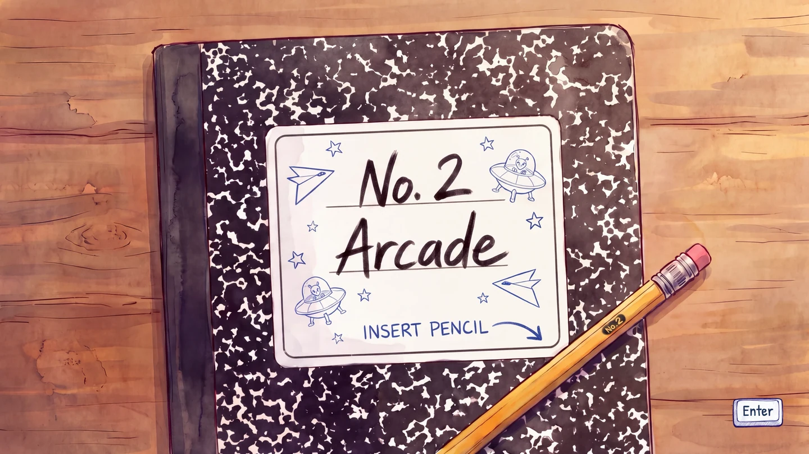
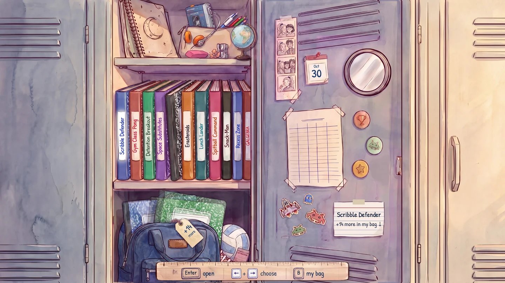
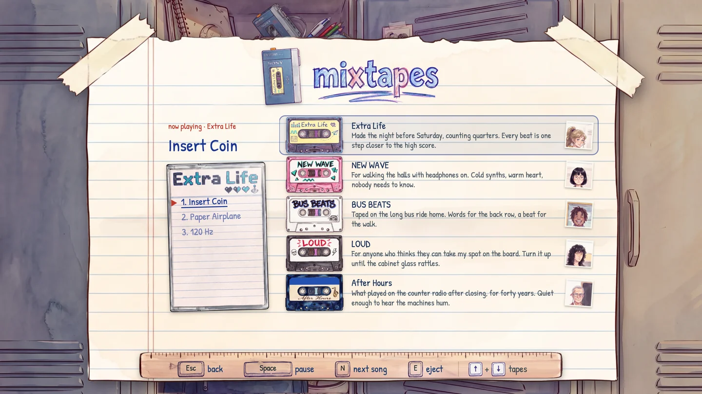
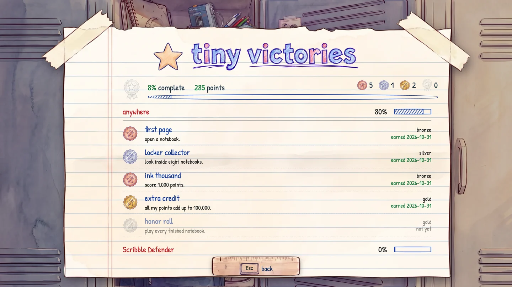
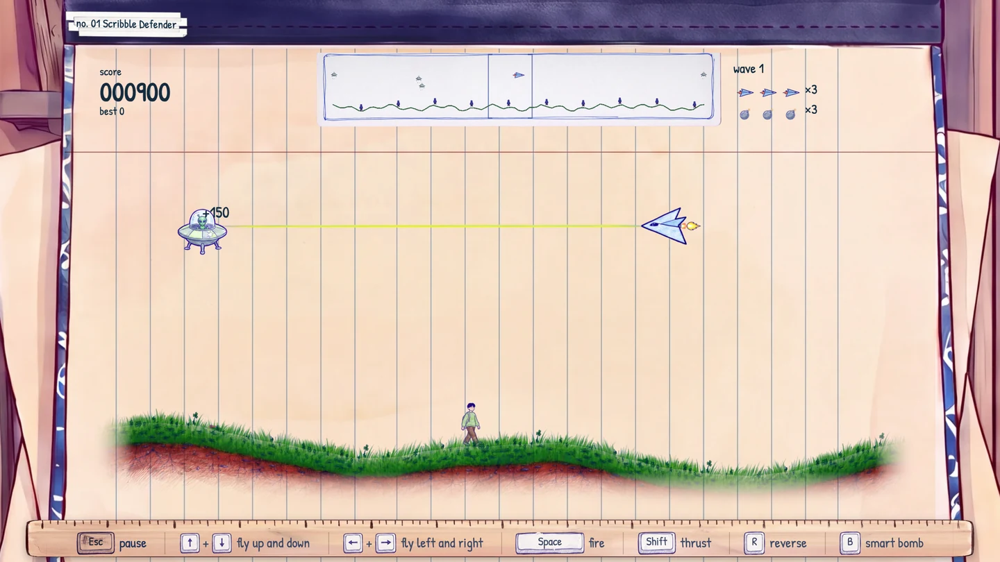

# Insert Pencil

**No. 2 Arcade**: twenty-four classic arcade games, redrawn as the notebooks of a high school girl who would rather be at the arcade.

| Her locker | The Walkman | Tiny victories | Scribble Defender |
| --- | --- | --- | --- |
|  |  |  |  |

**Play in the browser:** https://no2arca.de/

**Online scoreboard:** https://no2arca.de/scores/ (every game's board, by initials)

**Languages:** English, French, Spanish, German and Italian, chosen on the globe in her locker. The game names and songs stay in English.

**Or download it:** grab the zip from the [latest release](../../releases/latest), unzip it and open the HTML file in Chrome, Edge, Firefox or Safari. It is one file and works offline.

## Why I made this

The idea was simple: take the arcade games everyone already knows and has played, put them all in one place, and wrap them in a new presentation. Each game is a notebook in her school locker, drawn in her own ballpoint and colored pencil, with a short comic at the start that explains how she got there.

It was also, honestly, an exercise. I wanted to learn the current AI tools properly: what they are good at, where they break, and what iterating with them actually feels like over a real project instead of a demo. So treat this as a learning project more than a product.

## How it was made

- **Code:** written by Claude (Claude Code). My part was the design, the direction, the decisions and a lot of play testing and review.
- **Art:** generated with Google Gemini (Nano Banana, through the API and AI Studio), then art directed, picked and approved by me one asset at a time.
- **Music and sound:** music made with Google Lyria 3 Pro (Gemini API), one track for the locker, one for the comic and one for each game; the Walkman's five mixtapes are fifteen sung songs made with Lyria 3.5 from lyrics written for the game; sound effects made with ElevenLabs. Same rule as the art: nothing went in until I approved it.
- **Reviews:** I had ChatGPT and GitHub Copilot review what Claude and Gemini produced, so no single model was grading its own homework. ChatGPT also produced an alternative edition of the comic along the way.
- **Testing:** automated play sessions in a real Chrome window (Playwright) that drive each game, take screenshots and run rule checks for every game.

## The intro comic, or: where most of the time went

The eleven-page intro comic took longer than all twenty-four games. It went through three full revisions of the script and art direction, a complete alternative edition made with ChatGPT, an attempt to re-render that edition in the original style, and finally a return to the Gemini version. Along the way it took about 700 generated images for the comic and its cast alone (out of roughly 1,400 for the whole project), with single panels needing up to 17 tries. At Gemini's list prices that is somewhere around $100 to $170 in image generation for the comic, and $200 to $340 for all the art, before counting subscriptions.

The hard part was not getting a good image. It was getting the same characters, the same room and the same story beat to hold from one panel to the next: the hero's hair, which hand she draws with, where the Defender cabinet stands in the arcade, the colour of a jacket. Every fix risked breaking something that was already right, and every page needed several passes.

That was very different from my experience as a designer and producer working with real concept artists and art directors. With good people, one conversation was usually enough for them to understand the vision, and they brought their own ideas to it, so the final result was better than what I had in mind at the start. Here I had to spell out everything, check everything, and the tools never pushed back with a better idea. They are impressive, but they are not collaborators in that sense yet.

## The characters

Designing the cast was the fun part, and it changed a lot along the way. The main character started as a teenage boy and ended up as a high school girl with a yellow hoodie, a curly ponytail and a notebook full of games. Her friends, the bored older kid at the arcade and the arcade's owner all went through several redesigns.

The story itself is pretty dumb and could use much better writing. I know.

## Features

- 24 playable notebooks, each a remake of an original cabinet from 1972 to 1985, in the order they sit in her locker:
  - **Scribble Defender**: *Defender* (Williams Electronics, 1981; Eugene Jarvis and Larry DeMar). Her ship over the school's hills, saving classmates from the landers.
  - **Gym Class Pong**: *Pong* (Atari, 1972; Allan Alcorn). You against the gym coach.
  - **Detention Breakout**: *Breakout* (Atari, 1976; Nolan Bushnell and Steve Bristow). One wall at a time.
  - **Space Substitutes**: *Space Invaders* (Taito, 1978; Tomohiro Nishikado). Substitute teachers march down behind piles of books.
  - **Erasteroids**: *Asteroids* (Atari, 1979; Lyle Rains and Ed Logg). Rocks of eraser crumbs.
  - **Lunch Lander**: *Lunar Lander* (Atari, 1979; Howard Delman). Landing a lunch tray, gently.
  - **Spitball Command**: *Missile Command* (Atari, 1980; Dave Theurer). Defending the school from spitballs.
  - **Snack-Man**: *Pac-Man* (Namco, 1980; Toru Iwatani). Quarters and pizza in the school halls, chased by the principal and three administrators.
  - **Recess Zone**: *Battlezone* (Atari, 1980; Ed Rotberg). Green wireframe tanks on the playground.
  - **Galgebra**: *Galaxian* (Namco, 1979; Kazunori Sawano). Diving equations on graph paper, with power-ups the cabinet never had.
  - **Centigrade**: *Centipede* (Atari, 1981; Ed Logg and Dona Bailey). A centipede of grade letters among pink erasers.
  - **Froggology**: *Frogger* (Konami, 1981). Her backpack frog crosses a hallway and a river of lunch trays.
  - **Quiz**: *Qix* (Taito America, 1981; Randy and Sandy Pfeiffer). Claiming bubbles on a blank answer sheet.
  - **Testpest**: *Tempest* (Atari, 1981; Dave Theurer). Bugs climbing a ballpoint tunnel in her homework.
  - **Home Ec Scramble**: *BurgerTime* (Data East, 1982). Burgers built on her recipe card.
  - **Dunce Kong**: *Donkey Kong* (Nintendo, 1981; Shigeru Miyamoto). All four screens, in the cabinet's order.
  - **Dig Doug**: *Dig Dug* (Namco, 1982). Digging under the football field.
  - **Q\*Nerd**: *Q\*bert* (Gottlieb, 1982; Warren Davis and Jeff Lee). A pyramid of stacked school books.
  - **Jock Joust**: *Joust* (Williams Electronics, 1982; John Newcomer). Jocks on the school eagle and rival vultures.
  - **Robotron: Class of 2084**: *Robotron: 2084* (Vid Kidz for Williams Electronics, 1982; Eugene Jarvis and Larry DeMar). Punks, football players and a kindergarten field trip in the gym.
  - **Mystery Meat Time**: *Food Fight* (General Computer Corporation for Atari, 1983). A cafeteria food fight.
  - **Hall Patrol**: *Moon Patrol* (Irem, 1982; Takashi Nishiyama). A six-wheeled buggy down the school hallway.
  - **Term Paperboy**: *Paperboy* (Atari Games, 1985; John Salwitz and Dave Ralston). Delivering term papers on a street that changes by the day.
  - **Locker Gauntlet**: *Gauntlet* (Atari Games, 1985; Ed Logg). Always four players: the three students you don't pick play beside you, each in their own way.
- Original rules and scoring: I tried to keep each game true to its cabinet, and checked the scoring tables against the original manuals, source and ROMs where I could.
- Her school locker as the main menu, with notebooks on the shelves, a backpack for more, and a who's who of the cast.
- An eleven-page intro comic, narrated by her (voice made with ElevenLabs).
- Every notebook opens to a title page, a cheat sheet with the controls, the play page, high scores and a back page.
- Pause and game over screens on tracing paper taped over the game, written in her four-colour pen.
- Tiny victories: console-style trophies (bronze to platinum) for each game's own feats.
- High scores with typed initials, and an online leaderboard for every game. Each run is replayed on the game's own rules before it counts. You can turn sharing off with "share my scores online" in settings.
- Something broken? The detention slip behind her sneaker in the locker writes it up: a short problem report (only what you type, the game version and your browser, sent only when you press send) that becomes an issue on this repository, labelled "detention slip".
- Keyboard, mouse and touch, or a controller: on-screen prompts switch to Xbox, PlayStation or Steam Controller buttons to match the one connected, and settings can set up a pad whose buttons are in another order.
- Five languages: English, French, Spanish, German and Italian, picked on a pull-down map of Europe from the globe on her top shelf. The headings are hand-lettered again in each language, and the comic is re-lettered and re-narrated in each.
- A daily challenge on the calendar taped inside the door: the same game and the same start for everyone that day, with its own board.
- A gym report on the volleyball behind her sneaker: time played, games started, quarters spent, favourite notebook and best score.
- A "what's new" sheet after each update, also in settings.
- A demo mode in every game when you leave it alone.
- A Walkman behind her pencil pouch with five mixtapes, one from each character (heavy metal, techno, jazz, hip hop and new wave), three sung songs each with original lyrics (song lyrics can show as subtitles, see settings); the tape you pick plays in the locker and on every page. Click a song on the tape case to play it.
- An easter egg: a sixth, secret tape is hidden in the game, with its own songs and a face you won't see anywhere else. Hint: her maths teacher has a favourite number, and it shows up in scores too.
- Music for the locker, the comic and every notebook, plus sound effects recorded with ElevenLabs. A notebook's music plays on its pages; turn on "music during play" in settings to keep it going during the game.

## Tech

- One self-contained HTML file (about 210 MB, music and narration in five languages included) that runs offline in a browser.
- PixiJS on WebGL for the games, plus WebGL effects such as the blur under the tracing paper and the bending page turns. (An early version had a 3D classroom built with three.js; it was replaced by the locker.)
- Every game runs on a deterministic fixed-step engine (120 steps a second, seeded random numbers), so a run can be replayed exactly from its inputs. That is what makes the leaderboard checkable.
- Web Audio for sound (the music and effects are AAC files packed into the HTML and decoded in the browser; the games' own effects are recordings replayed at each game's own pitches), the Gamepad API for controllers.
- Leaderboard: a Cloudflare Worker with a D1 database on the free plan; a scheduled GitHub Action replays submitted runs and only verified scores are shown.
- Built with Node 24: `npm run build` writes `dist/No2-Arcade-v<version>.html`; `npm test` runs the rule checks for all 24 games and the leaderboard replays. The leaderboard server and its own setup notes are in `server/`.

## How long it took

The first version came together over two full weekends in October 2026, from the first playable Scribble Defender to all 24 notebooks and the online leaderboard. That was already longer than I planned, mostly because of the intro comic; the games themselves came together much faster than the story around them.

Since then it has been reworked again and again, from my own play sessions and from what other players told me: lots of experiments, and plenty of things redone from scratch (the hub alone went from a 3D classroom to her locker). The "what's new" sheet in settings keeps the latest rounds.

## Nothing here is perfect

This is surely buggy, and some games will feel off compared to the originals you remember. Feedback is very welcome: write it up on the detention slip behind her sneaker in the locker, or open an issue on this repository.

## Credits and notices

- Game names, rules and scoring are inspired by the original arcade games; their names, logos and trademarks belong to their owners. This is a non-commercial fan project and is not affiliated with or endorsed by any of them.
- Fonts: Patrick Hand, Permanent Marker and IBM Plex Mono, under the SIL Open Font License.
- PixiJS (MIT licence).
- Music: Google Lyria 3 Pro. Sound effects: ElevenLabs (elevenlabs.io).
- Paper texture: "Scanned Textures - Papers" by Clastic Artistic, used as an overlay inside the comic pages.

## Licence

- Code: MIT (see LICENSE).
- Art, comic, characters and story: Creative Commons Attribution-NonCommercial 4.0 (CC BY-NC 4.0), see LICENSE-ART.
- Third-party parts keep their own licences, listed in THIRD-PARTY-NOTICES.md.
